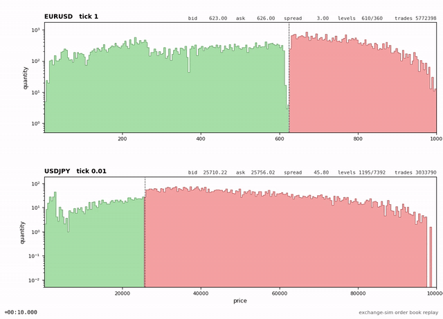
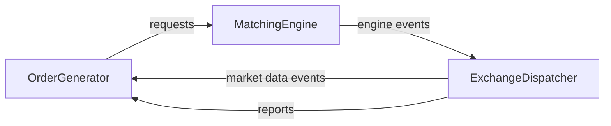

# exchange-sim

The simulator of electronic exchange core in C++23 (L3 order book with FIFO price-time matching, a market data feed and
execution reports), built and measured like production trading infrastructure.



*Order books of `EURUSD` and `USDJPY` generated by `ShiftOrderGenerator`: resting quantity per price level (logarithmic
scale), buys in green, sells in red.*

## Overview

`exchange-sim` models the venue side of an electronic market: a matching engine that keeps an L3 order book per
instrument with FIFO price-time priority driven by a synthetic order generator. All requests, reports and market data
events are timestamped with TSC and written to journals. The focus is carefully measured in-process round-trip latency
for the single-threaded apps and throughput for the multi-threaded apps.

The order generator, the matching engine and the exchange dispatcher are templated and run unchanged in three transport
designs: direct callbacks, a single-threaded event loop and multithreaded (one pinned thread per stage connected by
lock-free SPSC queues).

## Results

In-process round trip from sending a request to receiving its last report (`last_report`), `EURUSD`, `replay_el_app`,
nanoseconds:

| Request                                   | p50   | p99   | p99.9 |
| ----------------------------------------- | ----- | ----- | ----- |
| CANCEL                                    | 148   | 257   | 357   |
| ADD, 0 trades                             | 202   | 315   | 404   |
| REPLACE, 0 trades                         | 374   | 500   | 609   |
| ADD, trades against 10 resting orders     | 963   | 1,209 | 1,368 |
| REPLACE, trades against 10 resting orders | 1,079 | 1,335 | 1,513 |

`replay_cb_app` (direct callbacks instead of the event loop) is within 5% of these numbers. Throughput of the whole
pipeline:

| Application     | Design                               | Requests/s, median | Max run-to-run drift |
| --------------- | ------------------------------------ | ------------------ | -------------------- |
| `replay_cb_app` | Direct callbacks, one thread         | 3.25M              | 0.6%                 |
| `replay_el_app` | Event loop, one thread               | 3.30M              | 1.5%                 |
| `replay_mt_app` | Pinned thread per stage, SPSC queues | 3.95M              | 1.7%                 |

Intel Core Ultra 9 285K (turbo on), isolated cores, Ubuntu 26.04, Clang 21 `-O3 -flto=thin -march=native`, mimalloc; 20
runs of under 60 s (~188M requests) each. The multi-threaded app keeps up to 10 requests in flight, so its latency is
mostly queueing and is not comparable with the single-threaded numbers, see
[What we're measuring](#what-were-measuring). The methodology is in [benchmarking.md](docs/benchmarking.md). The full
tables including `USDJPY` and the breakdown by the number of trades are in
[benchmark_results.md](docs/benchmark_results.md).

## Main specifications

- Each stage satisfies the `ProcessorOf` concept. The same stage is compiled into callback, event-loop and multi
  threaded applications. Take a look at [architecture.md](docs/architecture.md).
- Each transport satisfies the `SinkOf` concept. `SPSCQueue` is lock-free with cached indices, correct memory ordering
  and 128-bytes separation of the producer and consumer states. `AlignedQueue` is a wrapper that puts every element on
  its own cache line.
- There are no heap allocations on the hot path: it's checked in runtime, `operator new` is overridden and
  `AllocatorTracking` sums up all allocations that actually happened after initialization. In case there are some
  allocations, the app fails after the loop.
- `StlL3BookContainer` that is used to store l3 book is basic `std::map` + `std::list` + `std::unordered_map`, but each
  node is preallocated with `PlaceArena`. Take a look at [matching.md](docs/matching.md).
- All requests, reports and market data events are timestamped with TSC and written to a journal. Events are joined by
  `origin_time` by `calc_stats` and those round trips are grouped by security, request type and the number of trades.
  `just evaluate` print latencies by percentile of each group.
- All benchmarks should be run on system with isolated cores, with huge pages allocated by OS and specific setup of
  `nohz_full`, `mlockall` and so on. The page cache is dropped prior to each run. Every run is fingerprinted.
  `just evaluate` emits `IMPROVED`/ `REGRESSED`/`INCONSISTENT` taking the drift into account. Take a look at
  [benchmarking.md](docs/benchmarking.md).
- `ShiftOrderGenerator` resemble a real market: it's basically a state machine per each security with quiet periods,
  price changes and book replenishment after price change. Take a look at
  [order_generation.md](docs/order_generation.md).

## Requirements

- Linux (developed and benchmarked on Ubuntu 26.04 LTS)
- C++23 compiler (GCC 15 or Clang 21, the presets and conan profiles specifically target those versions), CMake (>=
  4.2.3), Conan 2, Just, Ninja, ccache
- Docker (for limited restricted run inside the container)

Compiler versions used for development are GCC 15.2.0 and Clang 21.1.8.

The scripts expect an Intel CPU with `intel_pstate` and no SMT. Take a look at [benchmarking.md](docs/benchmarking.md)
for details.

## Quickstart

Please note that running the app inside Docker container does not bring the best isolation, hardware and OS settings to
the table and therefore will not show the best latencies or throughput. The purpose of Docker image is short demo on
devices where correct isolation would be impossible or inconvenient. Although running the app inside Docker has been
tested on laptop, it's not guaranteed to run correctly if the machine is not powerful enough since the app is designed
to run with pinned threads and correct isolation.

```
just create-docker-image
just run-docker
```

Inside Docker:

```
just generate-flow ./configs/machine-no-isol.json 10
just benchmark ./configs/machine-no-isol.json --apps simple_el_app replay_cb_app --reps 1 --skip-isolation-check --timeout 10
just evaluate ./configs/machine-no-isol.json --apps simple_el_app replay_cb_app --percentiles 50
```

Valid benchmarks require a machine with performance hardware and OS settings applied, take a look at
[benchmarking.md](docs/benchmarking.md) for details.

To quickstart on a bare metal machine run `just bootstrap` first. Next, you're going to need to create a valid config
with correct huge pages and core settings.

```
sudo just patch-grub <config>
sudo reboot

sudo just apply-runtime <config>
just build
just test
sudo prlimit --pid $$ --memlock=unlimited:unlimited
just generate-flow <config>
just benchmark <config> --apps shift_el_app replay_el_app --reps 10
```

Please note that both release and regular debug mode lock all memory with `mlockall` at startup and fail in case the
locked memory limit is too low.

## Architecture at a glance



The lifecycle of a single order is as follows:

- `OrderGenerator` decides what exactly is the request it wants to send next (either add, cancel or replace) and pushes
  it into the transport
- `MatchingEngine` ensures that security exists indeed and passes the request to the `L3Book` that maintains the
  respective security
- `L3Book` performs basic risk checks using RiskChecker
- `L3Book` updates the l3 book and outputs engine events to the `ExchangeDispatcher` via respective transport
- `ExchangeDispatcher` converts internal engine events into two streams: market data events (which is L3 feed) and
  reports
- Both streams go back to the `OrderGenerator` via respective transport

`OrderGeneratorWrapper` provides `OrderGenerator` with `GeneratorInterface`. `GeneratorInterface` timestamps all
requests on send with TSC timestamps, while `OrderGeneratorWrapper` timestamps all incoming market data events and
reports. All requests and events are journaled to files.

The transport layer is based on the `SinkOf` concept implemented using callbacks, queues or spsc queues.

A more thorough architecture is located in [architecture.md](docs/architecture.md). The exchange semantics is in
[matching.md](docs/matching.md).

## Designs

There are 8 apps that implement different order generations, design and transport between components.

| Application     | Transport                              | OrderGenerator | Design                                                              |
| --------------- | -------------------------------------- | -------------- | ------------------------------------------------------------------- |
| `simple_cb_app` | Direct callback, no queueing           | Simple         | Single-threaded                                                     |
| `simple_el_app` | Queues                                 | Simple         | Single event-loop on one thread                                     |
| `simple_mt_app` | Single-producer-single-consumer queues | Simple         | Each component on a separate thread that is pinned to separate core |
| `shift_cb_app`  | Direct callback, no queueing           | Shift          | Single-threaded                                                     |
| `shift_el_app`  | Queues                                 | Shift          | Single event-loop on one thread                                     |
| `replay_cb_app` | Direct callback, no queueing           | Replay         | Single-threaded                                                     |
| `replay_el_app` | Queues                                 | Replay         | Single event-loop on one thread                                     |
| `replay_mt_app` | Single-producer-single-consumer queues | Replay         | Each component on a separate thread that is pinned to separate core |

The suffixes stand for callback (`cb`), event loop (`el`) and multi threaded (`mt`). Empty app is `empty_app`. It's a
separate app that does nothing, all benchmark scripts skip it.

The securities are sharded by `section` in multi threaded apps, each section gets its own `MatchingEngine` pinned on
separate cores. `ExchangeDispatcher` polls all of these sections.

All single threaded apps require `2` isolated cores (`1` shared + `1` dedicated), while multi threaded apps require at
`3 + number of sections` cores (`number of sections` for `MatchingEngines`, `1` shared, `1` for `ExchangeDispatcher` and
`1` for `OrderGenerator`).

Currently `ShiftOrderGenerator` is not supported with multi threaded stages because of the current implementation of the
`ShiftOrderGenerator`, see [Restrictions](#restrictions).

## Order generation

There are currently three order generators implemented: `SimpleOrderGenerator` (fully random orders, good for simple
testing), `ShiftOrderGenerator` (state machine that resembles a real market with price changes and quiet periods) and
`ReplayOrderGenerator` (replays a recorded request journal as fast as possible).

Take a look at the [order_generation.md](docs/order_generation.md) for details.

## What we're measuring

Latency is measured as in-process round trip, a tsc timestamp is taken once the `GeneratorInterface` emits the request
and another tsc timestamp is taken once `OrderGeneratorWrapper` receives the market data/reports back. All
requests/reports/market data events are written to respective POD Journals along with timestamps, `calc_stats` then
matches events by origin_time and calculates the round-trips. Currently, `first_report`/`first_market_event` and
`last_report`/`last_market_event` round trips are calculated. The results are grouped by security, request type and the
number of trades the request initiated and aggregated by percentiles. The first `calc_stats.requests_to_skip` requests
are fully skipped as they are warming up the app.

Current latency includes the time events have spent waiting in the transport. In single threaded app each request is
fully processed before the next one is generated, so there's no wait at all. In multi threaded app there could possibly
be up to `max_pending_transactions` requests in flight. Multithreaded app cannot be compared with single-threaded app
directly. If there's a need to compare latency of a multithreaded app with a single-threaded app,
`max_pending_transactions` must be set to 1 so that there would be events of a single request in the queues. Multi
threaded apps are optimized for throughput instead of latency.

## Benchmarking

```
sudo just patch-grub ./configs/dmitrys-ubuntu.json && sudo reboot
sudo just apply-runtime ./configs/dmitrys-ubuntu.json
just benchmark ./configs/dmitrys-ubuntu.json --apps shift_el_app --reps 10
just evaluate  ./configs/dmitrys-ubuntu.json --apps shift_el_app --labels <label> --percentiles 50 99
```

`just patch-grub` replaces the kernel cmdline in `/etc/default/grub` and therefore needs a reboot. The
`just apply-runtime` cmd applies only runtime settings and therefore must be repeated after every reboot.

- `check_isolation` verifies the actual hardware and operating system state prior to every run (isolated cores,
  `nohz_full`, `rcu_nocbs`, huge pages, governor, turbo and so on)
- Metadata that contains the current setup, git states, application sha is written, runs are archived under labels
  (`branch-git_revision[:6](-dirty)` by default) with full fingerprint.
- The dirty page cache is drained prior to each run. Every run executes in a separate systemd-run scope pinned to
  isolated cores.

Take a look at [benchmarking.md](docs/benchmarking.md) for more info.

## Result evaluation

`just benchmark` runs each of apps several times, calculating the latencies during each run. `just evaluate` can either
evaluate a single app or compare two apps:

- Single app evaluation measures the drift of single app across runs by percentile. It emits either `-` or
  `INCONSISTENT` based on drift.
- Two-way app evaluation measures the difference between latency percentile of two apps. It emits either `-`,
  `REGRESSED` or `IMPROVED` based on data.
- Both modes print a summary with requests per second and rejections count by request type and rejection reason.

Either different apps can be evaluated or one app across different labels.

## Repository layout

```
base/       Common classes and types: SPSCQueue, Journal, StrongTypes and so on.
domain/     Core exchange types: Security, Price, Amount and so on
exchange/   The exchange itself
configs/    JSON run configs
scripts/    Python scripts, mostly benchmark orchestration and result printing
conan/      CMake conan wrapper and conan profiles

base/config/        JSON configuration implementation with glaze
base/logging/       Logging implementation with quill
base/threading/     Core isolation suite
base/time/          Tsc timestamping suite

exchange/application/   Applications: shift_el_app, calc_stats and so on
exchange/book_containers/   Different implementations of L3 book
exchange/domain/        Exchange-specific types: requests, reports, engine_events and so on
exchange/input/         Order generation classes: SimpleOrderGenerator, OrderGeneratorWrapper and so on
exchange/matching/      Matching related classes, matching engine and l3 book implementation
exchange/output/        External event output classes: ExchangeDispatcher
```

## Documentation

- [architecture.md](docs/architecture.md) - Documentation of architecture
- [matching.md](docs/matching.md) - Documentation of matching engine
- [order_generation.md](docs/order_generation.md) - Documentation of current order generation
- [benchmarking.md](docs/benchmarking.md) - Documentation of benchmarking architecture
- [benchmark_results.md](docs/benchmark_results.md) - Current benchmark results

## Scope

- Matching: FIFO price-time priority, deterministic per instrument
- Order operations: Add / Cancel / Replace
- L3 order book per instrument
- Synthetic order generator, market-data dispatcher, execution reports
- Benchmarking: latency and throughput

## Restrictions

- Currently `ShiftOrderGenerator` and `SimpleOrderGenerator` use only one ClientID{0}.
- There is no self-trade prevention at all.
- Currently `ShiftOrderGenerator` is not supported with multi-threaded stages because of the current implementation of
  the shift design. It needs an exact copy of L3 book of each security, implementation relies on exact current state of
  book.
- Journals and replay files are raw binary dumps of `Timestamped<std::variant<...>>` records without any specification.
  Any change to structures themselves makes these files unreadable for the app. The replay must be regenerated with
  `just generate-flow` after such changes.
- The apps terminate on any event that could negatively affect the benchmarks: a full journal queue, an empty book
  arena, an allocation on hot path and so on.
- Please note that the hard drive setup may affect the measurements. The replay app writes several million events per
  second. Please note that hard drive space may disappear in a blink.
- `calc_stats` expects every report and market event to arrive within 1s, a slower round-trip raises exception.
- Although mac-clang profile and mac-clang-debug-asan preset exist, it is not guaranteed code works or even is
  compilable on macOS. It will not be tested in CI and it should be used for development purposes only.

## Future plans

- Replace `boost::decimal` with integer ticks
- Comparison of `StlL3BookContainer` with other L3 book containers

## License

Copyright (c) 2026 Dmitry Gorbunov.

Unless otherwise indicated, this project is licensed under the PolyForm Strict License 1.0.0. See [LICENSE](LICENSE) for
the full terms.

The license permits noncommercial use but does not grant permission to modify or redistribute the software.

Third-party components and separately licensed files remain subject to their respective licenses.
