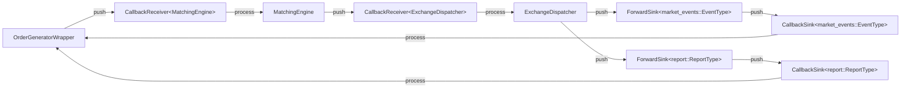
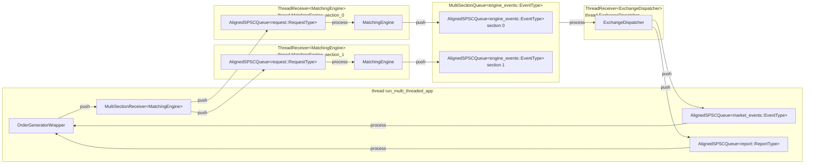

# Architecture

This document describes the architecture of current project.

## Abstract Pipeline

The exchange is a pipeline of three stages connected by typed message streams:

- `OrderGeneratorWrapper` sends `request::RequestType` to `MatchingEngine`
- `MatchingEngine` sends `engine_events::EventType` to `ExchangeDispatcher`
- `ExchangeDispatcher` sends `market_events::EventType` and `report::ReportType` to `OrderGeneratorWrapper`

Every message in these streams is `std::variant<PODTypes...>`. Each POD contains the `origin_time`: the TSC timestamp of
the request that initiated the event so that each event could be matched to its origin later. Each queue enforces the
limit of 64 bytes on each message with a `static_assert`.

A stage is a class that satisfies `ProcessorOf<Object>` concept, it contains `process(const Object&)` method. Each stage
emits objects into sink that satisfies `SinkOf<Object>`, it has `push(Object&&)` method. Concepts live in
`base/processor.h` and `base/sink.h` respectively and each message type defines its own concepts: `request::Processor`,
`request::Sink` and so on.

The stages do not know anything about the specific setup. The same set of classes could yield a completely different
design depending on how exactly they are wired.

Wiring utilities include:

| Wrapper                                          | What it does                                                                                                                                                              |
| ------------------------------------------------ | ------------------------------------------------------------------------------------------------------------------------------------------------------------------------- |
| `CallbackSink<Object, Callback>`                 | `push` to the sink calls a stored `std::function` straight ahead                                                                                                          |
| `CallbackReceiver<Object, Processor>`            | Owns the `Processor` and is a sink itself, which calls `BaseClass::process` on the stored `BaseClass`. A push to this `Sink` immediately invokes the `Processor`          |
| `ForwardSink<Object, Sink>`                      | `push` forwards the object through to a different `Sink` by pointer                                                                                                       |
| `event_loop::WrapVector<Vector>`                 | `push` appends to a vector, the event loop drains the vector afterwards                                                                                                   |
| `ThreadReceiver<Object, Processor, Queue>`       | constructs `Processor`, `SPSCQueue` and `std::jthread` pinned to its own leased core. This thread constantly pops objects from `SPSCQueue` and feeds them to `Processor`. |
| `MultiSectionReceiver<Object, Processor, Queue>` | One `ThreadReceiver` per security section, routes requests by `security_id`                                                                                               |
| `MultiSectionQueue<Object>`                      | One `AlignedSPSCQueue` per section, `consume` polls all of them                                                                                                           |

Those are three designs that implement the same stage graph:

| Design           | Transport                                                                                                           |
| ---------------- | ------------------------------------------------------------------------------------------------------------------- |
| `callback`       | `CallbackReceiver`/`CallbackSink`s are used, so all events are passed to next stage immediately                     |
| `event_loop`     | `WrapVector` is used as `Sink`, so each next stage is fed by all events that were pushed by previous stage in batch |
| `multi_threaded` | `ThreadReceiver` is used, so each stage is placed on separate thread pinned to separate core                        |

## Compiletime wiring

Each application is a small `main` that picks the transport and the design up. For instance, take a look at
`simple_cb_app.cpp`:

```
template<typename SinkType>
using AppOrderGenerator = OrderGeneratorWrapper<SimpleOrderGenerator,
    GeneratorInterface<SinkType, generator_interface_skills::PendingTransactions, generator_interface_skills::StoreOrders>,
    SinkType>;

template<typename SinkType>
using AppMatchingEngine = MatchingEngine<StlL3BookContainer, SinkType>;

template<typename MDSinkType, typename ORSinkType>
using AppExchangeDispatcher = ExchangeDispatcher<MDSinkType, ORSinkType>;

run_single_threaded_callback_app<AppOrderGenerator, AppMatchingEngine, AppExchangeDispatcher>(runtime, config);
```

Each stage is a template parametrized by output sink type. `run_single_threaded_callback_app` is a templated function,
so basically any `OrderGenerator`, any `MatchingEngine` and any `ExchangeDispatcher` could be wired into the app.

`exchange/*/*_concept.h` define what each component must provide: `concepts::OrderGenerator`, `concepts::MatchingEngine`
and `concepts::ExchangeDispatcher`. Each of `run_single_threaded_callback_app`, `run_multi_threaded_app` and
`run_single_threaded_event_loop_app` checks provided components with those concepts and `static_assert`s.

## Designs

Please note that although some apps are called single threaded, in fact logging and journals are still pinned to a
separate shared core.

### Callback

`run_single_threaded_callback_app` pins all the data processing to a single dedicated core.



A push into the `CallbackReceiver` calls `process` right away, so any request is fully processed and both market data
and reports are in the event buffers of `OrderGeneratorWrapper` before `send_order_add_request` returns. There are no
jams between the stages. The only buffering appear inside the wrapper which is drained on the next `generate_event()`
call. The market data and the report sinks are actually `ForwardSink`s since the `OrderGenerator` is constructed after
`ExchangeDispatcher`, while it needs its output sinks at a construction time.

The main loop is pretty straightforward:

```
while (!stop_token.stop_requested() && !order_generator.generator_stopped()) {
  order_generator.generate_event();
}
```

### Event loop

`run_single_threaded_event_loop_app` also runs on a single thread pinned to a dedicated core, but the stages are
connected with event loop instead of callbacks.

```
while (!stop_token.stop_requested() && !order_generator_wrapper.generator_stopped()) {
    order_generator_wrapper.generate_event();
    for (const auto& request : sinks->request_sink) {
        matching_engine.process(request);
    }
    for (const auto& engine_event : sinks->engine_event_sink) {
        event_dispatcher.process(engine_event);
    }
    for (const auto& market_data_event : sinks->market_data_generator_sink) {
        order_generator_wrapper.process(market_data_event);
    }
    for (const auto& report_event : sinks->report_generator_sink) {
        order_generator_wrapper.process(report_event);
    }
    sinks->request_sink.clear();
    sinks->engine_event_sink.clear();
    sinks->market_data_generator_sink.clear();
    sinks->report_generator_sink.clear();
}
```

Each stage basically processes everything the previous stage produced on current iteration. The sinks are
`boost::container::static_vector`s with a capacity of 1024, so no allocations happen. Please note that they never grow
as well. A single order that produces several hundred trades will overflow the queues.

Four static vectors are separated by padding and a `static_assert` check to guarantee that the prefixes of these vectors
are separate modulo 4096 to prevent 4K aliasing.

### Multi threaded app

`run_multi_threaded_app` places each stage and each section on its own thread and pins each thread to a dedicated core:



- Securities are shared by `security.section`. `MultiSectionReceiver` owns a single `ThreadReceiver<MatchingEngine` per
  each `SectionID` and `push` routes each request to the corresponding queue by `security_id`. Each `MatchingEngine` is
  created within its own `SectionID` and creates only books for securities from this section.
- `ExchangeDispatcher` is a `ThreadReceiver` that has a `MultiSectionQueue` as input: it's `number of sections` of SPSC
  queues, one SPSC queue per section. To obtain the next event from this queue, it iterates over all
  `number of sections` queues.
- The main thread consumes market data and reports from queues only if it's currently impossible to generate any more
  requests (`pending_transactions == max_pending_transactions`). The order the queues are drained in is alternated on
  each step.
- Within a single sections everything is FIFO, so the events of all securities in a single section are processed and
  journaled exactly in the order `OrderGenerator` produced them. Across sections the ordering may vary from run to run
  since the engines are being run in parallel.

All queues have `1 << 14` slots. `AlignedQueue` puts each slot on its own cache line to prevent producer and consumer
touching the same line. The queues never block: `SPSCQueue` is lock-free and overflow throws an exception that
terminates the whole application.

The startup waits until every `Receiver` report `ready_to_receive()` which means that thread is fully initialized,
pinned and ready to receive events. Take a look at [Shutdown](#shutdown) for the shutdown sequence.

If there are not enough of dedicated cores, `CoreAllocator` logs `No dedicated cores available, returning shared` and
returns the shared core instead. The app itself does not stop.

## Example lifetime of a single request

Here's what happens to a single `OrderAddRequest` in the event loop design.

- `ShiftOrderGenerator::generate_event()` decides to add an order and calls
  `GeneratorInterface::send_order_add_request(...)`.
- `GeneratorInterface` takes next `ClientOrderID` and increments it. It builds the request with
  `origin_time = Ticks::rdtscp()`, pushes it into the request sink and makes a copy into its request buffer.
- The event loop sends the request to `MatchingEngine::process` that checks the security and calls `L3Book::add` of
  corresponding security.
- `L3Book` runs the risk checks, checks for a duplicate client order id, sends `OrderAccepted` internal engine event,
  processes this order in L3 book and emits corresponding internal engine events.
- `ExchangeDispatcher::process` turns each of those internal engine events into market data events and reports. Take a
  look at [matching.md](matching.md) for specifications.
- `OrderGeneratorWrapper::process` takes `Ticks::rdtscp()` for each event and pushes them to the buffer.
- On the next `generate_event()` all those requests/events are being processed and journaled. The next event is
  generated afterwards.

## Pipeline

### Client side

`OrderGenerator` decides what order it should send to the exchange. It sends a stream of Add/Replace/Cancel.
`OrderGeneratorWrapper` provides `OrderGenerator` with `GeneratorInterface` to provide a convenient interface to send
orders to the exchange. Several skills can be connected to `GeneratorInterface` to maintain the correct order state
using `OrderStorage`, for example, or to maintain counters for pending transactions/active orders.

Take a look at [order_generation.md](order_generation.md) for the details, including the skills and the three
generators.

### Matching

`MatchingEngine` validates that `security_id` is valid and the security of request exists. Next, it routes the request
to that security's `L3Book`. It also owns the global order and trade id counters.

`L3Book` implements the whole matching logic: `RiskChecker` checks requests validity (max amount, lot size, price tick),
while `L3Book` checks duplicate `{client_id, client_order_id}` and implements FIFO price-time matching logic against the
opposite book half and possible resting order logic.

Book storage itself is behind the `BookContainer` concept, `StlL3BookContainer` is the reference implementation.

Take a look at [matching.md](matching.md) for the event reference.

### Output

`ExchangeDispatcher` converts internal engine events emitted by `L3Book`/`MatchingEngine` into two streams: market data
events and reports.

## Journaling and timestamps

Each app opens three `ThreadedJournal<File, ...>` in write mode: for requests, market data events and reports
correspondingly. `calc_stats` reads those files back through plain `Journal<File, ...>`. A single journal record is
`Timestamped<POD>` that is the message followed by a `Ticks` TSC timestamp. Each journal record is written as it is, the
same binary format as the structure, so it's important to read journal by the same build that wrote it.

`ThreadedJournal` is a `Journal` with SPSC queue and a thread pinned to shared core. This thread reads events from queue
and flushes them to the file. If the thread can't keep up and the queue fills up, an exception that terminates the
application is thrown. The application does not silently drop records.

The timestamps are TSC ticks, `rdtscp` is used so that it would wait for all the preceding instructions to complete. The
frequency is calibrated once at startup. `calc_stats` must be run on the same machine as it recalculates the same
frequency and uses it afterwards.

The replay file is simply a request journal that is fully read into the memory through `InMemoryFile`. `InMemoryFile`
reads the whole files into 1GB huge pages at startup, so the replay generator does not touch nvme itself during the run.
Those pages come from the same kernel pool as mimalloc's, `just patch-grub` reserves
`huge_os_pages_count + huge_os_pages_file_count` 1GB pages.

## Runtime

Every app starts with `read_config_and_initialize_logging` from `base/run.cpp`. It does the following:

- `mi_option_purge_delay` is set to `-1` to prevent the return of memory to the OS by mimalloc.
- `SIGINT`, `SIGTERM`, `SIGHUP` and `SIGUSR` are blocked.
- `mlockall(MCL_CURRENT | MCL_FUTURE)` on Linux builds without sanitizers so that nothing ever pages out.
- JSON config is read and settings are verified. Unless the app is secondary (like `calc_stats`), the number of reserved
  huge os pages is checked (what mimalloc requested, not what OS actually provides). The app refuses to start in case of
  mismatch.
- `Runtime` is created: `CoreAllocator` with cores from the config, a `std::stop_source` and `ShutdownSignalThread`.
- quill logging is initialized.
- The main thread is pinned to shared core.
- TSC frequency is calibrated.

Every `run_*` function leases a dedicated core and pins the main thread to it afterwards.

`fallback_to_none: true` disabled all pinning and the app ignores `cpu_cores` entirely. This option is used to quickly
run the app in environment that does not allow core pinning: like Docker or MacOS. Note that config must be updated with
`without_systemd: true`, `skip_isolation_check: true`, `skip_cache_drop: true` to run in such environments.

### Core allocation

`CoreAllocator` hands out `CoreLease`. A core lease can be `DEDICATED` (one exclusive dedicated core), `SHARED` (the one
shared core, could be leased any number of times) or `NONE` (in case no core pinning is required).
`CoreLease::pin_thread(name)` pins the current thread to the core and sets the name of the thread. A `CoreLease` is a
RAII wrapper, so the dedicated core is returned automatically once `CoreLease` is destroyed. On MacOS there's no core
pinning, so only the name of the thread is set.

### Logging

Quill is used as the core of logging. There basically is one root logger and each `LoggableClass` gets a named logger.
The macros `INFO`, `DEBUG`, `WARNING`, `ERROR` pick the correct logger from the current scope up: inside the
`LoggableClass` it's the instance logger, otherwise it's the root one. The backend thread runs on the shared core, so
basically the cost of logging is a push to the queue by quill frontend. `log_level` is picked up from the config.

`CHECK(condition, fmt, ...)` is the assertion. It is not removed with specific defines and the whole project relies on
this behavior. It logs `CRITICAL`, flushes the log and throws `std::runtime_exception`.

cpptrace is used to catch exceptions on high level and print valid stack traces for debug purposes.

### Shutdown

`ShutdownSignalThread` runs on the shared core and waits for `SIGINT`/`SIGTERM`/`SIGHUP`.

- The first signal requests stop on the `Runtime` `std::stop_source`. Every main loop checks
  `stop_token.stop_requested()`, so the app starts finishing the execution
- The second signal more than 100ms later terminates the whole process. The delay is there since utilities like
  `timeout` send the signal to both the process and the process group

## Memory allocations on hot path

The goal is to make sure nothing is allocated, nothing page-faults or gets swapped while the main loop executes.

- mimalloc replaces the global `operator new`/`operator delete`. In addition `AllocatorTracking` tracks all allocated
  memory after the initialization. mimalloc reserves 1GB huge pages during startup, never purges (`purge_delay = -1`).
- `mlockall` locks everything that is mapped or will be mapped.
- Every container that could grow during the run is reserved up front. Please note that reservation relies on the values
  in config and may need to be adjusted if any parameters change.
- Although `StlL3BookContainer` keeps `std::map`, `std::list` and `std::unordered_map`, their nodes actually come from
  preallocated `PlaceArena` with `CustomAllocator`.

Note that the allocation checks do not cover startup, initialization and shutdown.
