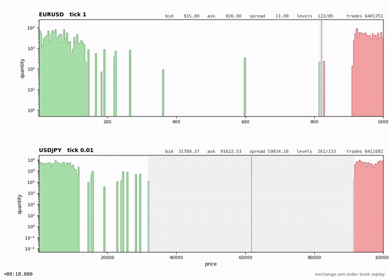
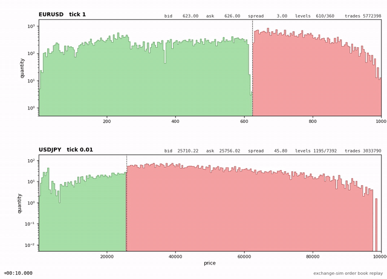

# Order generation

The client side of the pipeline contains three layers:

- `OrderGenerator` is the brain of order generation - it decides which requests exactly to send to the matching engine.
  Currently there are three types: `SimpleOrderGenerator`, `ShiftOrderGenerator` and `ReplayOrderGenerator`.
- `GeneratorInterface` is the interface that `OrderGenerator` communicates with. It builds the requests into exact
  structures, generates `ClientOrderID` and contains the skills `OrderGenerator` needs to get the current exchange
  state.
- `OrderGeneratorWrapper` hosts `OrderGenerator`, links it to `GeneratorInterface` and receives both market data and
  reports from the pipeline. It also maintains the journals.

All three components are templates, the application links them in a few `using` lines, for example:

```cpp
template<typename GeneratorInterface>
using AppShiftOrderGenerator = ShiftOrderGenerator<StlL3BookContainer, GeneratorInterface>;

template<typename SinkType>
using AppOrderGenerator = OrderGeneratorWrapper<AppShiftOrderGenerator,
    GeneratorInterface<SinkType,
        generator_interface_skills::PendingTransactions,
        generator_interface_skills::StoreOrders,
        generator_interface_skills::MaintainBook<StlL3BookContainer>>,
    SinkType>;
```

## GeneratorInterface

`GeneratorInterface<SinkType, Skills...>` is a template that defines the interface that `OrderGenerator` communicates
with. It inherits from all the `Skills...` and gives the generator three main methods: `send_order_add_request`,
`send_order_cancel_request` and `send_order_replace_request`. Each of them generates the next id, timestamps the
request, copies the request to the buffer and pushes it to the request sink. The buffer will be journaled and applied on
the next `generate_event`.

There are also a couple of helper methods: `asked_to_stop()` (checks if the application has started the shutdown
sequence), `inform_generator_stopped()` (`ReplayOrderGenerator` uses it to notify that there's nothing left to send in
the replay), `reserve(size)` to preallocate skills and `lease_core(core_type)` to lease a core for the generator.

## Skills

A skill receives every event and keeps the current state of the exchange. Skills are inherited by `GeneratorInterface`,
so their API becomes public for `OrderGenerator`. Each generator declares which skills it needs with a `requires`
statement.

### PendingTransactions

`PendingTransactions` counts requests that have not been processed yet. Each request increments the counter and the
final reports decrement it. Every generator returns `false` from `generate_event` in case
`pending_transactions() >= max_pending_transactions`. In the single-threaded designs the counter is always zero at
generation time as all requests are processed immediately. However, in the multi-threaded designs it limits how many
requests can be in flight simultaneously.

### StoreOrders

`StoreOrders` keeps an `OrderStorage` per security. `OrderStorage` tracks each order sent by the client by
`{client_id, client_order_id}`. It keeps the state machine of each order:

| State          | Entered on                                         | Left on                                                                                                           |
| -------------- | -------------------------------------------------- | ----------------------------------------------------------------------------------------------------------------- |
| `SENT`         | `OrderAddRequest`                                  | `OrderAccepted` -> `ACCEPTED`, `OrderRejected` -> removed                                                         |
| `ACCEPTED`     | `OrderAccepted`, `ReplacementAccepted` (new order) | `OrderBookEntry` -> `ACTIVE`, `OrderFilled` or `OrderExpired` -> removed                                          |
| `ACTIVE`       | `OrderBookEntry`                                   | `OrderCancelRequest` -> `CANCEL_SENT`, `OrderReplaceRequest` -> `REPLACE_SENT`, `OrderFilled` -> removed          |
| `CANCEL_SENT`  | `OrderCancelRequest`                               | `OrderCancelled` -> removed, `CancellationRejected` -> `ACTIVE` or removed if it was filled meanwhile             |
| `REPLACE_SENT` | `OrderReplaceRequest`                              | `ReplacementAccepted` -> removed, new order in `ACCEPTED`, `ReplacementRejected` -> `ACTIVE` or removed if filled |

`active_orders()` is a subset of all orders that are in the `ACTIVE` state. They are kept in two `IndexedMap`s, one per
direction, so that a random active order could be picked by `OrderGenerator` in `O(1)`.

Each transition is checked with `CHECK`, so every transition of order state is verified. The application terminates if
there's an unexpected transition.

### MaintainBook

`MaintainBook` keeps a full L3 book for each security. It's built from the market data feed only. The underlying book
could be any `BookContainer`, for instance, currently `StlL3BookContainer` is used in both `MatchingEngine` and
`OrderGenerator`. It's used in `ShiftOrderGenerator` to calculate the beat amount from the current L3 book.

### DebugOrders

`DebugOrders` prints every request, report and market data event at `DEBUG` level. It's not currently wired into any
app, but it could be useful for debugging.

## OrderGeneratorWrapper

`OrderGeneratorWrapper` is a wrapper around `OrderGenerator` that links `GeneratorInterface` to it. It also processes
arriving market data events and reports, they are pushed to a buffer. The next `generate_event` applies the events from
the buffer first, they are journaled and passed to the skills and only then `OrderGenerator::generate_event` is called.

## SimpleOrderGenerator

`SimpleOrderGenerator` is a simple order generator. It basically selects all parameters at random: order type
(add/replace/cancel), security, price, quantity and so on. Although it's simple, it's a good starting point and it's
good for basic testing of `MatchingEngine`.

On every `generate_event`:

- If some security has `max_active_orders_by_security` or more active orders, the generator cancels a random active
  order of it.
- If some security has fewer than `min_active_orders_by_security` active orders, the generator adds a random order of
  it.
- Otherwise, it picks a random type (add, cancel or replace) and a random security. The next order has a random price
  and quantity, random time in force and random direction.



## ShiftOrderGenerator

`ShiftOrderGenerator` is an order generator that tries to resemble real market orders. The goal of this generator is to
simulate the actual stages when prices do not change and the price shifts during trading. It's a state machine
consisting of three stages: `QUIET`, `REPLENISH` and `SHIFT`. Each security has its own current state. The initial
starting state is `SHIFT` with an empty order book. Every `generate_event` picks a random security and asks it for one
request.



### SHIFT

The `SHIFT` stage represents a stage when prices are shifted. At the beginning of this stage, the generator generates a
random price shift and therefore selects a new `middle_price`. Then it generates either cancels in any direction or
beats in the direction of the price shift until there are no orders with `Direction::BUY` and `price > middle_price` and
no orders with `Direction::SELL` and `price <= middle_price`. After that it transitions to the `REPLENISH` stage.

### REPLENISH

The `REPLENISH` stage represents a stage when there are too few orders in the book. It selects the new order count and
generates new limit orders until `active_orders_count >= new_order_count`. New orders are generated with random prices
and quantities. After that it transitions to the `QUIET` stage.

### QUIET

The `QUIET` stage represents a stage when there are enough orders in the book. It generates all types of events: add
order, replace order, cancel order and beats.

The current state limits the types of generated events: an add order can't be generated if
`active_orders_count >= max_active_orders_by_security`, a cancel order can't be generated if
`active_orders_count <= min_active_orders_by_security` and so on.

After each beat the `QUIET` stage replenishes the book with the exact orders that have been beaten. Partly filled orders
are not replenished.

The `QUIET` stage ends once it sends `max_quiet_state_sent_orders_count` orders. After that it transitions to the
`SHIFT` stage.

### Prices of new orders

The direction is picked with probability proportional to the room on each side of `middle_price`, so the wider side gets
more orders. The distance from `middle_price` has a triangular distribution: most orders are placed close to the middle
price and the further from it, the fewer orders there are, down to none at `low_price` and `high_price`. Buy prices are
at or below `middle_price`, sell prices start at `middle_price + security.tick_size`. Quantities are uniform in
`[lot_size, max_book_order_amount_in_lot_sizes * lot_size]`.

### Beats

A beat is either an aggressive order or a replace that fills orders on the opposite side of the book. It's generated
using an existing copy of the order book provided by the `MaintainBook` skill. It selects a direction randomly (or uses
the direction of the shift during the `SHIFT` stage), selects the number of levels to be fully filled and generates the
amount so that these orders could be fully filled by the beat. The level after the last one is beaten by an amount that
doesn't reduce the level to zero.

## ReplayOrderGenerator

`ReplayOrderGenerator` simply reads requests from a file and feeds them to the `MatchingEngine` as fast as possible. It
allows measuring the performance of the `MatchingEngine` without the additional overhead of generating the requests and
it gives each design and each build exactly the same input. For instance, it currently doubles the throughput of the
whole app compared to `ShiftOrderGenerator`.

- The replay file is read into 1GB huge pages during initialization (`InMemoryFile`). Replay never touches the nvme
  after that. `memory.huge_os_pages_file_count` in the config is the budget for these pages.
- Every replayed request goes through exactly the same `GeneratorInterface` methods and gets a fresh `origin_time`. The
  generator checks that the generated id equals the id of the request being replayed.
- Replay reproduces the recording only with the same `securities` list in the same order - the file stores ids and not
  symbols.

It's important to note that although `ReplayOrderGenerator` specifically passes exactly the same requests, it does not
maintain the same time difference between requests - it simply pushes them as fast as possible with a restriction on
`max_pending_transactions`.

### Recording a flow

It's convenient to generate an initial replay file with

```
just generate-flow <config> <timeout> <app>
```

The defaults are `./configs/dmitrys-ubuntu.json`, 150 seconds and `shift_el_app`. It simply runs the app with
`just run-one` and copies the generated `journaling.requests` to `order_generator.generated_replay`. Any app with either
`SimpleOrderGenerator` or `ShiftOrderGenerator` could be used.

## ShiftOrderGenerator and multi-threaded design

`ShiftOrderGenerator` calculates beats and decides state transitions based on its local copy of the book that comes with
a delay. In the multi-threaded design up to `max_pending_transactions` requests are allowed to be pending and the local
`OrderStorage` and L3 book are behind. A beat computed from a stale book trades a different amount, refills no longer
match and the generator fails.
